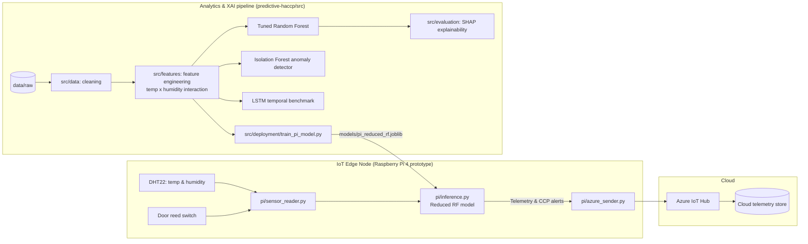
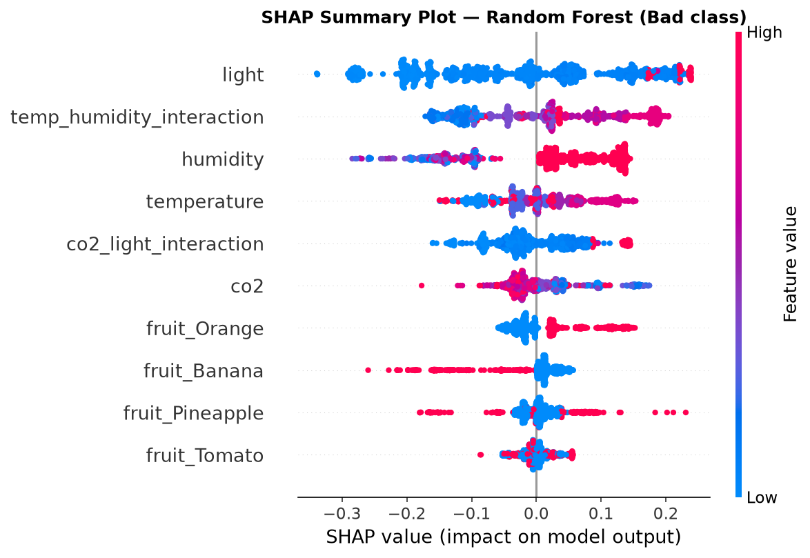

# AI-Enabled Predictive HACCP Using IoT-Based Environmental Monitoring

[](https://opensource.org/licenses/MIT)
[](https://www.python.org/)
[](https://scikit-learn.org/)
[](https://www.tensorflow.org/)
[](https://github.com/slundberg/shap)
[](https://www.raspberrypi.com/)
[](https://azure.microsoft.com/en-us/products/iot-hub/)

An end-to-end **Explainable AI (XAI)** and **IoT edge computing** framework that moves food safety monitoring from reactive checks to proactive, predictive **Hazard Analysis Critical Control Point (HACCP)** monitoring.

By tracking storage conditions (temperature, humidity, light, CO₂), the system flags conditions associated with spoilage risk, explains its decisions with SHAP, and runs real-time inference on a Raspberry Pi.

📄 **Full write-up:** the complete dissertation is available as [Final project report.pdf](./Final%20project%20report.pdf).

---

## Architecture Overview



---

## Key Features

- **Predictive HACCP compliance:** replaces periodic manual checks with continuous, automated environmental risk monitoring.
- **Explainable AI (XAI):** SHAP TreeExplainer and dependence plots reveal non-linear risk thresholds, such as the combined effect of temperature and humidity.
- **Edge deployment:** a reduced Random Forest that uses only features a DHT22 sensor and door switch can provide, running locally on a Raspberry Pi.
- **Supervised and anomaly detection:** high-precision classification (Random Forest) combined with unsupervised anomaly detection (Isolation Forest) for unlabelled data.
- **Cloud integration:** optional sending of sensor readings and alerts to Azure IoT Hub.

---

## Benchmark Results

Test-set results from [`predictive-haccp/reports/tables/final_summary_all_models.csv`](predictive-haccp/reports/tables/final_summary_all_models.csv):

| Model | Task / Dataset | Recall | Precision | F1-Score | ROC-AUC | Target Deployment |
| :--- | :--- | :---: | :---: | :---: | :---: | :--- |
| **Random Forest (tuned)** | Supervised classification (Fruit Spoilage) | **1.0000** | **0.9981** | **0.9991** | **1.0000** | Central server / cloud analytics |
| **Isolation Forest (tuned)** | Anomaly detection (Fruit Spoilage) | **0.9868** | 0.6140 | 0.7570 | 0.8175 | Unlabelled cold-chain storage |
| **Pi Reduced Random Forest** | Lightweight classification (11 Pi-compatible features) | **0.9737** | 0.8132 | **0.8862** | **0.9451** | **Raspberry Pi edge device** |
| **LSTM (sequence length 30)** | Temporal benchmark (UCI Occupancy) | **0.9006** | 0.6220 | 0.7358 | **0.9632** | Continuous time-series monitoring |
| Logistic Regression (baseline) | Supervised classification (Fruit Spoilage) | 0.9605 | 0.8617 | 0.9084 | 0.9511 | Comparison baseline |

> **HACCP metric priority:** in food safety, **recall** comes first, because a missed spoilage event (false negative) is the costliest error. All three Fruit Spoilage models reach at least 97% recall.

The Pi model's 11 features are temperature, humidity, their interaction, rolling means and standard deviations, deltas, door-open count and hour of day. Because the fruit dataset has no timestamps, the rolling and time features are approximated during training (see `src/deployment/train_pi_model.py`).

---

## Project Structure

All runnable code lives in **`predictive-haccp/`**. Run every command below from inside that folder.

```text
ai-enabled-predictive-haccp-iot-monitoring/
├── README.md                          # This file
├── LICENSE                            # MIT License
├── Final project report.pdf           # Dissertation / final project report
├── requirements.txt                   # Minimal dependencies for the root EDA script
├── predictive_haccp_eda.py            # Initial exploratory data analysis script
├── eda_outputs/                       # EDA report and figures
├── Dataset/                           # Original dataset downloads
│
└── predictive-haccp/                  # Main project
    ├── requirements.txt               # Full training dependencies
    ├── data/
    │   ├── raw/                       # fruit_spoilage/, uci_occupancy/
    │   └── processed/                 # Cleaned and feature-engineered datasets
    ├── src/
    │   ├── data/                      # load_data.py, clean_fruit.py, clean_occupancy.py
    │   ├── features/                  # feature_engineering.py
    │   ├── models/                    # train_baselines.py, train_random_forest.py,
    │   │                              # train_isolation_forest.py, train_lstm.py
    │   ├── evaluation/                # shap_analysis.py, comparative_evaluation.py
    │   └── deployment/                # train_pi_model.py (reduced edge model)
    ├── pi/                            # Raspberry Pi edge scripts
    │   ├── config.example.json        # GPIO pins, model path, Azure settings
    │   ├── sensor_reader.py           # DHT22 + door switch logging (or --simulate)
    │   ├── inference.py               # Real-time risk scoring
    │   └── azure_sender.py            # Optional Azure IoT Hub telemetry
    ├── models/                        # Trained models (.joblib, .keras)
    └── reports/
        ├── tables/                    # Metrics and comparison tables
        ├── figures/                   # Confusion matrices, SHAP plots, learning curves
        └── experiment_logs/           # Experiment log
```

---

## Getting Started

### 1. Set up the environment

```bash
git clone https://github.com/asmeromberhane/ai-enabled-predictive-haccp-iot-monitoring.git
cd ai-enabled-predictive-haccp-iot-monitoring/predictive-haccp

python3 -m venv venv
source venv/bin/activate        # Windows: venv\Scripts\activate

pip install -r requirements.txt
```

The raw datasets are already included in `predictive-haccp/data/raw/`, and the trained models in `predictive-haccp/models/`.

### 2. Run the ML and explainability pipeline

From the `predictive-haccp/` folder, run in this order:

```bash
# 1. Clean the raw data
python3 -m src.data.clean_fruit
python3 -m src.data.clean_occupancy

# 2. Feature engineering
python3 -m src.features.feature_engineering

# 3. Train models
python3 -m src.models.train_baselines
python3 -m src.models.train_random_forest
python3 -m src.models.train_isolation_forest
python3 -m src.models.train_lstm              # requires TensorFlow

# 4. Train the reduced Raspberry Pi model
python3 -m src.deployment.train_pi_model

# 5. Explainability and final comparison
python3 -m src.evaluation.shap_analysis
python3 -m src.evaluation.comparative_evaluation
```

Outputs are written to `models/`, `reports/tables/` and `reports/figures/`. Rerunning the scripts overwrites the included results.

### 3. Try the edge pipeline without hardware

```bash
python3 pi/inference.py --simulate        # score a simulated reading for each fridge
python3 pi/sensor_reader.py --simulate    # log simulated sensor readings (Ctrl+C to stop)
```

---

## Raspberry Pi Edge Deployment

### Hardware Requirements

- **Raspberry Pi** (3B+, 4B or Zero 2 W running Raspberry Pi OS)
- **2× DHT22 / AM2302** temperature and humidity sensors (one per fridge)
- **2× magnetic door reed switches** (open/closed detection)
- **4.7 kΩ–10 kΩ pull-up resistors** for the DHT22 data lines

### Wiring (defaults in `pi/config.example.json`)

| Fridge | Component | Component Pin | Raspberry Pi Pin (BCM) | Physical Header Pin |
| :--- | :--- | :--- | :--- | :--- |
| A | DHT22 | VCC | 3.3V | Pin 1 |
| A | DHT22 | DATA | GPIO 4 | Pin 7 |
| A | DHT22 | GND | Ground | Pin 6 |
| A | Door switch | Terminal 1 / 2 | GPIO 17 / Ground | Pin 11 / Pin 9 |
| B | DHT22 | DATA | GPIO 22 | Pin 15 |
| B | Door switch | Terminal 1 / 2 | GPIO 27 / Ground | Pin 13 / Pin 14 |

Fridge B's DHT22 shares 3.3V and Ground with Fridge A. Change the pins in `config.json` if your wiring differs.

### Running on the Pi

1. Copy the whole `predictive-haccp/` folder to the Raspberry Pi. The scripts find `models/pi_reduced_rf.joblib` relative to this folder.
2. Install the edge dependencies:
   ```bash
   cd predictive-haccp
   pip3 install pandas numpy scikit-learn joblib adafruit-circuitpython-dht gpiozero azure-iot-device
   ```
3. Create your configuration. Add your Azure IoT Hub connection string and set `"enabled": true` if you want cloud telemetry:
   ```bash
   cp pi/config.example.json pi/config.json
   nano pi/config.json
   ```
4. Start logging sensor readings:
   ```bash
   python3 pi/sensor_reader.py
   ```
5. In a second terminal, start the risk scoring loop:
   ```bash
   python3 pi/inference.py --watch
   ```

Never commit `pi/config.json`, because it contains your Azure connection string.

---

## Explainability (XAI) Insights

SHAP analysis ranked the engineered **`temp_humidity_interaction`** as the second most important indicator of spoilage risk overall, ahead of temperature on its own (see `reports/tables/shap_interpretation.csv`).

- **Critical control point trigger:** risk rises sharply once the standardised interaction value exceeds **+0.5**, which gives a data-driven basis for automated HACCP corrective-action triggers.



---

## Limitations

- The datasets have no microbiological ground truth (swab tests or contamination counts). The system identifies **environmental conditions associated with spoilage risk**, not confirmed contamination.
- The Pi model's rolling and time features are approximated from a dataset without timestamps, so real-world Pi performance still needs validating with live sensor data.
- The LSTM is trained on the UCI Occupancy dataset as a temporal benchmark, not on food-spoilage data.

---

## Datasets & Acknowledgements

1. **Fruit Spoilage Environmental Dataset:** Mendeley Data, DOI: [10.17632/czz68d9fwj.1](https://doi.org/10.17632/czz68d9fwj.1)
2. **UCI Occupancy Detection:** Candanedo, L.M. & Feldheim, V. (2016). Accurate occupancy detection of an office room from light, temperature, humidity and CO2 measurements using statistical learning models. *Energy and Buildings*, 112, 28–39.

---

## Author

**Asmerom Berhane**: [GitHub](https://github.com/asmeromberhane) · [LinkedIn](https://www.linkedin.com/in/<your-profile>)

## License

This project is licensed under the **MIT License**. See the [LICENSE](LICENSE) file for details.
